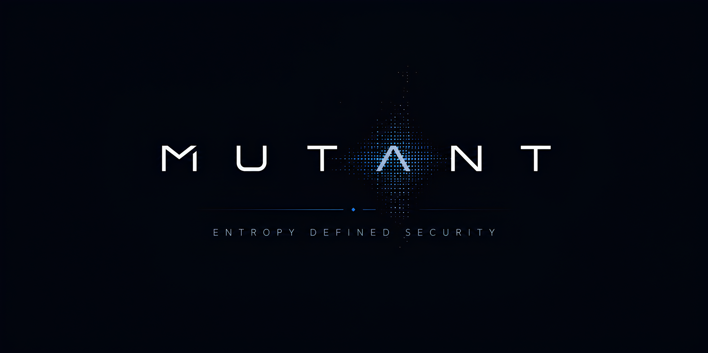

<p align='center'>
  
</p>

# The [mutant](https://mudocs.aoiflux.xyz) Programming Language

mutant is an open source programming language for security research and digital
forensics. Programs compile to encrypted bytecode, run in the Mutant VM, and
can be packed into standalone binaries for other platforms.

Current release: **2.6.1** -- see [CHANGELOG.md](CHANGELOG.md) for what changed
and [docs/advisories](docs/advisories/README.md) for the security advisories.

## Why mutant

- **Small language.** Simple enough to learn in under an hour.
- **Encrypted bytecode.** A compiled program is protected on disk and in memory.
- **Runs anywhere, ships anywhere.** One VM on every platform, and standalone
  binaries cross-compiled for others.
- **Batteries included.** A **694-builtin** standard library in pure Go (no
  cgo): data handling, networking, cryptography, detection, graphs and a deep
  forensic suite. See the [Capability Reference](docs/CAPABILITY_REFERENCE.md).
- **Real tooling.** A formatter, a test runner, a debugger, and the `mlsp`
  language server behind the [VS Code extension](mutant-vscode-extension/README.md).

## Install

Download a binary from this repository's releases, or build from source with
[Go](https://go.dev/dl/):

```bash
git clone https://github.com/aoiflux/mutant
cd mutant
./scripts/build.sh --host-only          # Linux, macOS, WSL
```

```powershell
./scripts/build.ps1 -HostOnly           # Windows
```

A plain `go install` also works, but its binary cannot run `mutant release`:
that needs the runtime assets the build scripts embed.

## Quick start

```bash
mutant                     # start the REPL
mutant hello.mut           # compile to encrypted bytecode: hello.mu
mutant hello.mu            # run the bytecode
mutant test ./lib          # run every *_test.mut file
mutant help                # every command, and `mutant help <command>`
```

Compiling and running both ask for a password. By default it is prompted for,
never typed on the command line:

| Option                    | Use it for                                                           |
| ------------------------- | -------------------------------------------------------------------- |
| _(nothing)_               | Interactive use. Prompts with terminal echo disabled.                |
| `--password-file <path>`  | Unattended runs. Refused if the file is readable by other users.     |
| `--password-stdin`        | Pipelines: `mutant hello.mu --password-stdin < secret`.              |
| `--dev`                   | Local development only. Uses a built-in key that is **not secret**.  |
| `--password-insecure <v>` | Only if you accept that other local users can read it from `ps`.     |

A bare `--password` is refused since 2.6.0. There is deliberately no
environment-variable form; see
[docs/CONFIGURATION_POLICY.md](docs/CONFIGURATION_POLICY.md).

New to mutant? Start with the
[30-minute tutorial](docs/TUTORIAL_30_MIN.md).

## Standalone binaries

```bash
mutant release hello.mut --os windows --arch amd64
```

Targets: `darwin/amd64`; `linux/amd64`, `linux/386`, `linux/arm64`,
`linux/arm`; `windows/amd64`, `windows/386` (`x86` is accepted as `386`). Any
other pair is refused.

A program runs in secure mode by default: a hit from the runtime's security
probes ends the run. `--compat` warns and continues instead. See
[docs/EXECUTION_MODES.md](docs/EXECUTION_MODES.md).

## Examples

- [examples/](examples/README.md) -- runnable programs by area, from text
  matching to filesystems, network recon and registry triage
- [examples/workshop/](examples/workshop/README.md) -- QUILLDROP, a two-hour
  guided investigation built for the DFRWS APAC 2026 workshop
- A browser REPL built to WebAssembly (experimental):
  [docs/WASM_REPL_REFERENCE.md](docs/WASM_REPL_REFERENCE.md)

## Documentation

The [official website](https://mudocs.aoiflux.xyz) covers all things mutant.
Guides in this repository:

- **Learn:** [Tutorial](docs/TUTORIAL_30_MIN.md) ·
  [Cookbook](docs/COOKBOOK.md) · [What is mutant](docs/WHAT_IS_MUTANT.md) ·
  [Comparison with other tools](docs/COMPARISON.md)
- **Reference:** [Language](docs/MUTANT_LANGUAGE_REFERENCE.md) ·
  [Builtins](docs/CAPABILITY_REFERENCE.md) ·
  [Structured data](docs/STRUCTURED_DATA.md) ·
  [Interchange schemas](docs/INTERCHANGE_SCHEMAS.md) ·
  [Graph database](docs/GRAPH_DATABASE.md) ·
  [Secure networking](docs/SECURE_NETWORKING.md) ·
  [Runtime integration](docs/RUNTIME_INTEGRATION.md)
- **Tools:** [Testing](docs/TESTING.md) · [Debugging](docs/DEBUGGING.md) ·
  [Language server design](docs/LSP_EXTENSION_LLD.md) ·
  [Language server onboarding](docs/LSP_EXTENSION_ONBOARDING_60_MIN.md)
- **Security:** [Advisories](docs/advisories/README.md) ·
  [Reporting a vulnerability](SECURITY.md)

## Featured in

- [Gopherlabs Conference 2021 by CloudNativeFolks](https://youtu.be/rhSwwGSt90c?t=2223)
- [Nullcon Goa Sep 2022](https://archive.nullcon.net/website/goa-2022/speakers/pushing-security-left-by-mutating-byte-code.php)
  ([video](https://youtu.be/ivrM8rytaKY))
- [DEFCON AppSec Village 1st Place Winning Entry](https://eval.blog/research/breaking-the-mutant-languages-encryption/)
- [Hackaday - This Week in Security](https://hackaday.com/2023/08/18/this-week-in-security-tunnelcrack-mutant-and-not-discord/)

## Contributing

See [CONTRIBUTING.md](CONTRIBUTING.md) for building, the pure-Go and
cross-platform rules, and the release gate. Please also read the
[Code of Conduct](CODE_OF_CONDUCT.md).

## License

Mutant, including the language implementation and the language server in this
repository, is licensed under GNU AGPL v3.0 only. See [LICENSE](LICENSE).
